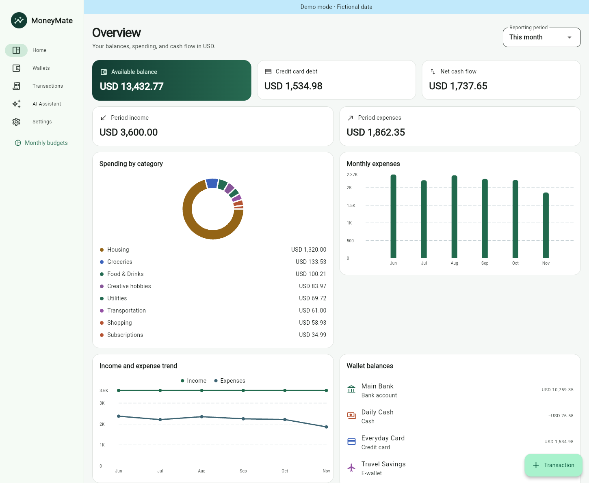
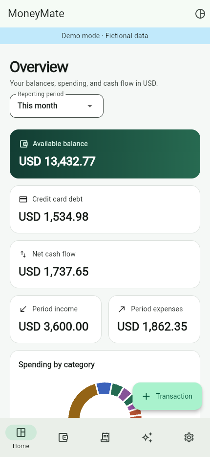
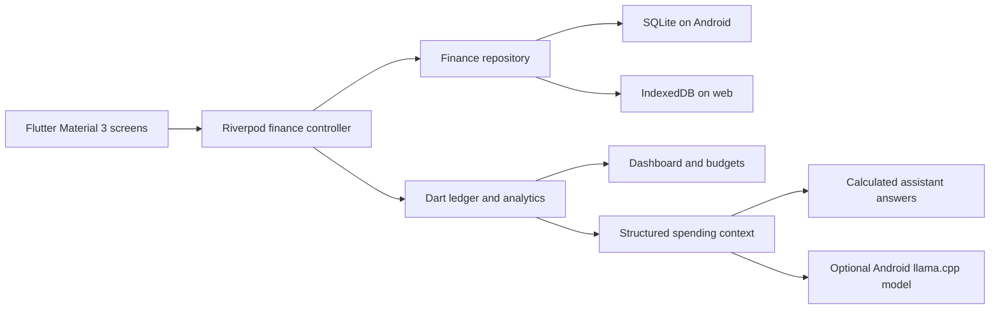

# MoneyMate

MoneyMate is an offline-first Flutter app for tracking personal spending, managing wallets, and planning monthly budgets. It uses integer minor units and derives balances from the ledger, so editing a transaction updates the reports and affected wallets together.

## Features

- Cash, debit, credit card, bank, and e-wallet accounts with editable icons, colors, opening balances, and archived history
- Income, expenses, and same-currency transfers with searchable descriptions, date filters, and wallet histories
- Credit card purchases, refunds, and bill payments. Purchases count as expenses, refunds reduce card debt, and bill payments move funds without counting the purchase twice.
- Responsive dashboard with reporting periods, wallet totals, a category donut, monthly expense bars, and income and expense lines
- Overall and category-specific budgets by calendar month, with remaining amounts, overspending, and prior-month comparisons
- Separate fictional demo ledger, locally persisted preferences, and versioned JSON export and restore
- Calculated spending answers on both platforms, with optional on-device language model suggestions on Android

## Screenshots

See the dashboard with fictional data in **Settings → Demo mode**. Mobile uses bottom navigation, while wide windows show a sidebar and multi-column dashboard.





## Platform support

| Feature | Android | Web |
| --- | --- | --- |
| Wallets, transactions, budgets, reports, demo | Yes | Yes |
| Local storage | SQLite in private app storage | IndexedDB per site and app path |
| JSON export and restore | Android system file picker | Browser download and file picker |
| Offline startup | After installation | After the first successful offline cache installation |
| Spending assistant and saved chat | Yes | Yes |
| Optional Qwen model | Supported 64-bit Android devices | Calculated answers only |

The repository and AI interfaces keep the finance code independent of the platform. The desktop storage adapter uses Sembast in the application support directory. A native Windows runner is future work.

## Architecture



`lib/src/core` contains the ledger model, validation, and calculations. `lib/src/data` owns persistence and Riverpod state. Feature folders own screens and platform-specific services. Navigation uses go_router and charts use fl_chart.

The repository persists a versioned snapshot for each ledger. A single transaction or atomic record write commits a whole edit, including both sides of a transfer. The ledger validates IDs, relationships, currencies, and amount bounds before commit. Separate keys hold the personal ledger, demo ledger, and preferences. Snapshot keys are indexed by the storage engine. The current design loads and queries an entire ledger in memory, which suits personal use. Large histories are a candidate for indexed per-entity storage.

## Local setup

Install [Flutter 3.50.0](https://docs.flutter.dev/install/archive), Android Studio with the Flutter plugin, JDK 21, Android SDK Platform 36, and NDK 28.2.13676358. Open this directory as a Flutter project in Android Studio and select your Flutter SDK. Flutter builds the Android runner in `android/`.

```sh
flutter doctor -v
flutter pub get
flutter run -d chrome
flutter run -d DEVICE_ID
dart format --output=none --set-exit-if-changed lib test
flutter analyze
flutter test
```

## Android APK and signing

Build a universal release APK or target ARM64 for a smaller download. The app supports Android 7.0 or later.

```sh
flutter build apk --release
# Smaller APK for ARM64 devices
flutter build apk --release --target-platform android-arm64
```

The APK is written to `build/app/outputs/flutter-apk/app-release.apk`. Local builds use the development signing key unless you provide a release key. Use the same distribution key for every public update.

1. Create a key with `keytool -genkeypair -v -keystore moneymate.jks -keyalg RSA -keysize 3072 -validity 10000 -alias moneymate`.
2. Create the ignored `android/key.properties` with `storeFile`, `storePassword`, `keyAlias`, and `keyPassword`. Use forward slashes in a Windows absolute path. Keep the keystore and credentials private.
3. For GitHub Releases, add repository secrets `ANDROID_KEYSTORE` (base64 of the keystore), `ANDROID_STORE_PASSWORD`, `ANDROID_KEY_ALIAS`, and `ANDROID_KEY_PASSWORD`. Push a version tag such as `v1.0.0` to run the Android release workflow.
4. Download the ARM64 APK from **Releases** on the Android device. Compare its SHA-256 with the release checksum, open the APK, and allow installation from the app that opened it if Android asks.

## Web build and GitHub Pages

```sh
flutter build web --release --no-web-resources-cdn --base-href /REPOSITORY/
python3 tool/prepare_web.py
```

Serve `build/web` at the matching path. To test locally at the root, rebuild with `--base-href /`, rerun the preparation script, and run `python3 -m http.server 8080 --directory build/web`. Service workers require HTTPS or localhost. The preparation script generates a versioned cache from the compiled files, including the local renderer and assets. After the cache finishes installing, the app can open with the network disconnected. Close other MoneyMate tabs to activate a newly installed release.

On GitHub, select **Settings → Pages → GitHub Actions**, then push to `main` or run **Web and GitHub Pages**. The workflow checks the app, detects the repository subpath, and deploys the release. The site will normally be available at `https://USERNAME.github.io/REPOSITORY/`. Hash routes support direct links on static hosting.

## Local AI model

On Android, open **Settings → On-device AI model → Download model**. The optional [Qwen3 0.6B Q4_K_M GGUF model](https://huggingface.co/Qwen/Qwen3-0.6B-GGUF) is 397 MB, Apache-2.0 licensed, and requires 500 MB of free internal space to install. MoneyMate downloads a pinned file and checks its SHA-256 before installation. Remove the file from the same panel.

The [llamadart](https://pub.dev/packages/llamadart) runtime runs llama.cpp inference on the CPU. Qwen3 was chosen for its compact quantized download and published GGUF weights. Gemma 3 1B was considered as a larger alternative with separate model terms. MoneyMate uses calculated Dart answers in browsers because the runtime’s web inference depends on experimental WebGPU support. On Android, the model uses the question and ledger summary to select one of the follow-up suggestions prepared by Dart. Every displayed amount comes from the ledger analytics.

## Privacy and data behavior

MoneyMate has no account, server, or bank connection. The local ledger and device-side analysis keep financial data off remote services. Initial web loading, web updates, and optional model downloads use the network. Android automatic app backup is disabled. Exported JSON is readable and excludes chat and preferences. Import validates the file before replacing the matching personal or demo ledger.

Browser clearing, private browsing, storage eviction, or uninstalling the app can remove local data. Export backups regularly and store them somewhere you control. Reports cover one currency at a time. Cross-currency transfers and exchange-rate conversion are outside the current scope. Card refunds and adjustments reduce card debt. Spending reports show gross purchases, and monthly budgets use recorded gross expenses.

The web build bundles its renderer and Latin text font. Characters outside the bundled font's coverage may appear as missing glyphs in a browser.

## Future work

- Native Windows packaging and platform verification
- Exchange-rate support and CSV import
- Indexed storage and virtualized history for much larger ledgers
- On-device performance and response quality evaluation across Android hardware
